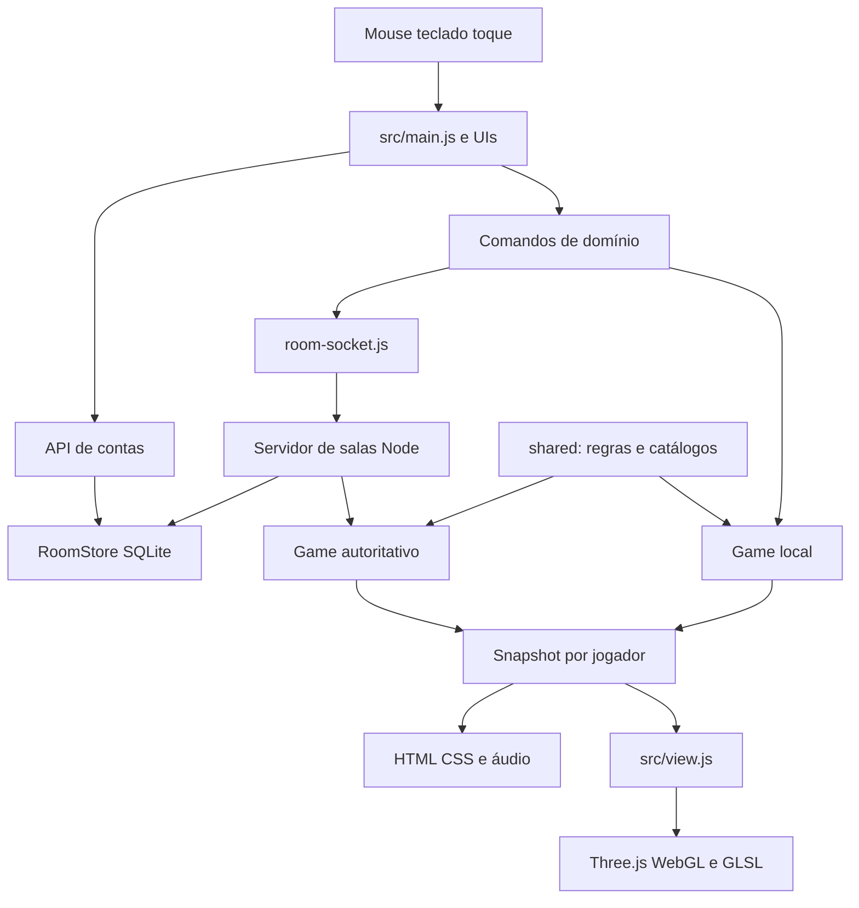

# Runtime e rede

## Componentes e direção das dependências

`shared/simulation.js` fornece `Game`. Os módulos de modo e de sistemas acrescentam métodos a `Game.prototype` usando `Object.assign`. É composição por conjuntos de métodos, não herança profunda nem um ECS. A ordem da instalação importa quando nomes se repetem; Bonk é instalado explicitamente ao final.

`src/main.js` é o composition root do cliente: cria sessão, view, áudio, UIs, controles, lobby e ligação com a conta. `src/view.js` reúne câmeras, atores, terreno, seleção e diversos renderizadores especializados. São módulos grandes e com alta centralidade; a divisão em arquivos especializados ainda não equivale a um agendador único de renderização.

## Caminho de execução local

O `requestAnimationFrame` de `main.js` faz, nesta ordem geral:

1. Atualização da entrada e estado de salvamento.
2. Acúmulo do tempo real, limitado a 0,1 s por frame.
3. Simulação em passos fixos de `1/30` s enquanto houver tempo acumulado e a partida local estiver ativa.
4. Criação do snapshot por jogador.
5. Atualização do mundo 3D e envio de comandos à GPU.
6. Atualização do áudio.
7. Interface geral em cadência aproximada de 100 ms; componentes também têm assinaturas próprias de invalidação.

O frame captura erros e identifica a etapa que falhou. Perda de contexto WebGL tem tratamento próprio. Uma tela de erro não prova sozinha um problema de GPU: a falha anterior de `random` sem receptor era uma exceção de simulação.

No modo local, simulação, geração de snapshots, montagem de efeitos, áudio e DOM disputam a thread principal do navegador. O servidor estar rápido não elimina um engasgo local.

## Caminho online

`server/game-server.js` mantém salas, membros e conexões. O cliente envia intenção; `Game.command(playerId, command)` e os métodos do modo validam e aplicam a ação. A apresentação não decide dano, drops ou gastos.

Os valores padrão de `server/runtime-config.js` são 30 Hz de simulação e 10 Hz de snapshots. São configuráveis por ambiente e possuem limites. O servidor usa um intervalo que percorre as salas; atualmente não existe um processo ou worker por sala. Uma sala cara pode atrasar o trabalho das demais no mesmo processo.

O protocolo inclui criação/entrada, lobby, escolha de personagem, início, comandos, estado, rejeição, chat, reconexão e manutenção. O lobby novo separa espera e seleção de herói. O host coordena o início, mas não se torna autoridade do combate.

### Snapshots e redução de tráfego

`snapshotFor(owner)` produz a visão do jogador. Alguns modos filtram informação por visibilidade; no Ragnarok, inventários privados de outros heróis são removidos. Isso não é uma especificação universal de fog of war para todos os modos.

O cliente anuncia capacidades para:

- Receber o mundo estático uma vez por chave de mapa/revisão, em Ragnarok e Dungeon.
- Receber biblioteca de habilidades somente quando sua chave muda.
- Confirmar sequência de comandos de movimento para replay local.

Essas otimizações já existem. Um plano de desempenho não deve propor sua primeira implementação como se ainda fossem ausentes. O primeiro snapshot é maior; o estado seguinte pode omitir mapa, obstáculos ou catálogo, e o cliente recompõe o que ficou em cache.

A key de cache precisa acompanhar todas as dependências reais. Disponibilidade de habilidade, por exemplo, depende de nível/classe além do loadout; mudanças futuras devem manter as chaves do servidor e do cliente coerentes.

### Movimento previsto

`src/room-socket.js` e os módulos de replay/interpolação guardam os comandos locais ainda não confirmados. A previsão refaz movimento elegível, não combate, compra ou loot. Deve usar a mesma regra de velocidade, colisão, redução durante conjuração e knockback da simulação autoritativa.

Nunca resolver uma divergência autorizando atravessar paredes ou reenviando dano. Reconexão, estado antigo, morte e mudança de fase precisam invalidar previsões inadequadas. Os testes de replay cobrem esse contrato.

## Contas e persistência

Há duas famílias de estado:

| Estado | Responsabilidade |
| --- | --- |
| Sessão, menu, foco, posição de janelas | Cliente; parte é persistida no dispositivo |
| `Game` e sala online | Servidor autoritativo; checkpoint recuperável |
| Personagens, estoque de cartas, peças e Kafra | API de conta, validadores e banco |
| Token de recuperação, vínculo à identidade do site | API de autenticação; não entram em snapshots públicos |
| Geometrias, materiais e caches visuais | View; não são salvos com a partida |

`server/room-store.js` usa `DatabaseSync`, WAL e migrações de `drizzle/`. A interface `prepare().bind().first()/run()` também permite reaproveitar handlers escritos para uma forma de API D1. A produção VPS atual persiste em SQLite; isso não significa que todas as contas residam em um serviço D1 externo.

Salas são salvas periodicamente e em ações importantes; o laço atual também grava checkpoints em cadência de cinco segundos. A escrita SQLite e a serialização são síncronas no processo Node. É um ponto a medir para várias salas.

A conta usa validação estrutural, limites de payload e controle de concorrência. O estoque de cartas e o ledger de encaixes pertencem ao servidor. O endpoint `/api/ragnarok/cards/socket` consome uma cópia e emite um recibo; uma sala online consulta esse recibo na conta vinculada antes de aplicar o encaixe. Comandos de restauração ou encaixe interno não são aceitos diretamente da rede.

O progresso do personagem ainda tem trechos baseados em checkpoints enviados pelo cliente. Validar formato e reconciliar cartas não transforma toda a economia offline em uma economia antifraude autoritativa. Novas recompensas compartilhadas precisam definir explicitamente sua autoridade.

## Publicação e operação

`scripts/build-game-site.mjs` executa Vite, gera catálogo de áudio e empacota fontes/guia/artefatos necessários. `deploy/Dockerfile` faz build em Node 24 e executa o servidor com usuário sem privilégios, dados em volume e healthcheck.

O workflow `.github/workflows/vps-production.yml` valida testes e build antes de publicar imagem imutável por SHA, enviar assets versionados a R2 e atualizar a VPS. O branch de implantação é `master`; o checkout de trabalho pode ter outro nome.

Checklist técnico de uma versão:

1. Testes adequados e build passam no mesmo código que será publicado.
2. Asset versionado e manifesto concordam; não substituir bytes de um nome imutável.
3. Imagem efetivamente executada corresponde ao SHA.
4. `/healthz` retorna pronto e persistência está ativa.
5. HTML aponta ao novo bundle e os assets têm a política de origem correta.
6. Migrações/checkpoints antigos continuam carregáveis ou possuem tratamento de incompatibilidade.

O healthcheck informa disponibilidade e custo observado do loop do servidor. Não mede FPS, GPU ou latência do dispositivo do jogador. Instalação, backups e rollback permanecem em [HOSPEDAGEM](../HOSPEDAGEM.md), [COMECE_AQUI_VPS](../COMECE_AQUI_VPS.md) e nos scripts de operação.
