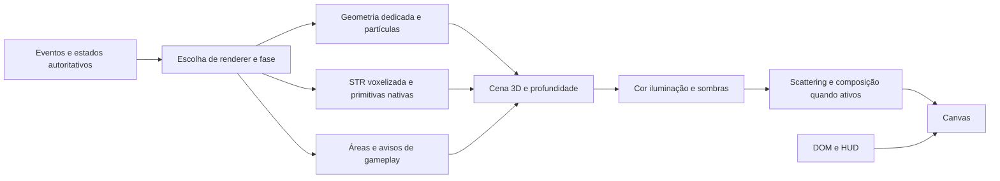

# Shaders e efeitos

## Pipeline visual atual

`view.js` monta o mundo, atualiza atores e sistemas especializados, prepara as rotas de efeitos e renderiza com `WebGLRenderer`. Materiais base incluem Lambert com cores de vértice; há shaders locais em `ShaderMaterial` e alterações via `onBeforeCompile`. O projeto não usa um editor visual de shaders.

A configuração base habilita antialias, pixel ratio limitado a 1,65, sombras PCF suaves e ACES Filmic. O caminho de atmosfera/pós-processamento usa targets próprios e composição. UI em HTML fica fora do canvas e não deve receber o filtro de pixel.

## Responsabilidade dos shaders

Shader transforma vértices e/ou calcula pixels; não é local para mudar dano, gerar moeda ou decidir se um cast acertou. Ele pode animar vento, fogo, brilho, água, dithering, contorno e aparência de superfície com base em dados já decididos.

Material compartilhado deve receber atributos/uniforms de forma controlada. Mudar um uniform global por ator sem separar o contexto pode fazer todos piscarem ou congelarem juntos. Cores e transformações por instância são preferíveis para famílias numerosas.

A saída precisa respeitar color space, tone mapping e alfa. Preto de textura não pode virar retângulo opaco. Luz aditiva não deve aumentar indevidamente o alfa do framebuffer. Profundidade e descarte devem preservar oclusão sem esconder o personagem atrás de um quadrado translúcido.

## Pós-processamento, pixel e contorno

`ro-light-scattering.js` reúne captura, raios e composição, com resolução limitada conforme perfil. `ro-atmosphere.js` controla iluminação/ciclo e a visibilidade solar. Existem controles separados para estilo, intensidade de pixel, contornos, geometria e intensidade de raios.

Pixel em 0% desativa a grade de pixel daquele caminho. Isso não muda automaticamente a malha, o material do terreno ou o acabamento do contorno. A percepção de serrilhado pode continuar vindo de silhouette, outlines, buffers de menor resolução ou superfície detalhada.

O orçamento do scattering declara dois render targets e duas chamadas extras, até 24 amostras de raio, com limites diferentes para cor nítida/nativa e para raios. O teto de cor nativa é 8,4 milhões de pixels e o teto estimado desse caminho é 224 MiB. São limites de projeto, não uma medição de VRAM usada em toda frame. Targets/resolução, sombras e transparência devem entrar na captura de GPU.

Ao criar um passe, salvar e restaurar render target, viewport, scissor, tone mapping, exposição e política de estatísticas. O módulo atual trata esses estados; não acrescentar um segundo compositor sem considerar essa integração.

## Dono e prioridade de cada efeito

Os mesmos eventos podem passar por vários sistemas. A rota atual usa `prepare`, `handles` e `legacyState` para reservar o efeito e remover fallback apenas quando existe substituição completa. Filtrar cegamente todos os eventos de uma skill também apagaria número de dano, miss ou lifesteal.

| Família | Implementação principal |
| --- | --- |
| Corte básico/impacto sólido | `ro-solid-hit-art.js`, `ro-melee-motion.js` |
| Katars e giro | `ro-katar-*`, `ro-rolling-cutter-art.js`, `ro-assassin-impact-art.js` |
| Feitiços de mago | `ro-mage-spell-art.js` e regras `ro-mage-spells.js` |
| Flechas caindo | `ro-arrow-rain-art.js` e `ro-arrow-rain.js` |
| Meteoros | `ro-meteor-art.js` e regras correspondentes |
| Fogo e explosão | `voxel-fire.js`, impactos de fogo e áreas elementais |
| Água | `visual-fluid.js`, `voxel-fluid-surface.js`, `voxel-water-art.js` e camadas elementais |
| Veneno | Nova de veneno, estados e geometria dedicada |
| Sangue e morte | `ro-body-fragments.js` |
| Cavalo de Pau | `ro-cart-revolution-art.js` |
| Mineração/receita | `ro-mining-art.js` |
| Fonte/ambiente/companheiros | Sistemas específicos ligados à view |
| Efeito do cliente Ragnarok | `ro-native-effect-system.js`, STR, primitivas e roteamento |

O [inventário de módulos](MODULE_INVENTORY.md) contém nomes concretos e imports, inclusive famílias que não aparecem nesta tabela resumida.

### Rotas nativas e voxelização de sprite

O bridge atual usa STR em modo `voxelOnly` e restringe primitivas a tipos sólidos admitidos. Várias habilidades dedicadas e fases de hit são excluídas dessa rota para não duplicar o efeito.

`ro-effect-voxels.js` amostra cor/alfa de atlas e converte amostras em cuboides instanciados. Isso é geometria 3D, mas sua composição pode continuar lembrando uma imagem extrudada. É uma ponte de compatibilidade, não substituto automático para a coreografia 3D desejada. Raios, lâminas, mãos, projéteis e explosões importantes devem ter trajetórias/volumes próprios.

## Água e fluidos

`visual-fluid.js` é uma simulação cosmética limitada de partículas, com interação entre vizinhas, pressão, gravidade, viscosidade e obstáculos. Não é um sistema completo de fluidos que altera toda a física do mapa.

O budget atual é 512 partículas, até 48 vizinhas consideradas, passo de 1/60 s e no máximo seis substeps por update. Há limites de velocidade, vida, obstáculos e recuperação após gaps. A superfície em `voxel-fluid-surface.js` reúne células e elimina faces internas: até 4.096 células, 12.000 faces e atualização de até 30 Hz. A fonte utiliza emissores/bacia e geometria de água própria.

A impressão de líquido vem de continuidade de fluxo, coesão, mistura e superfície, além da cor azul. Multiplicar cubos soltos sem ligação pode ficar mais caro e menos convincente. Priorizar continuidade e trajetória; aumentar detalhe por distância/área visível quando houver orçamento.

## Fogo, eletricidade e impactos

Fogo usa camadas geométricas e materiais animados, com recursos compartilhados e vida limitada. Queimadura/lava são estados autoritativos que ativam apresentação. Raio deve conectar origem/alto da cena e alvo, ramificar e terminar; emissividade e glow controlado produzem leitura sem adicionar uma PointLight por segmento.

O padrão de hit comum é pequeno: flash do corpo e poucos fragmentos coerentes ao material. Sangue para criaturas apropriadas; resina/geleia para Poring; cascas para madeira; estilhaços para pedra/gelo. Uma morte segue o estado/animação e pode desfazer o corpo em fragmentos. Anel de choque deve comunicar um impacto que precisa dele, não qualquer hit ou morte.

O rastro é memória curta da lâmina, não uma máscara de dano gigante. Em primeira pessoa, arma/mão e liberação da skill precisam ser vistas; ocultar o corpo local não pode ocultar todos os efeitos do ataque.

## Orçamentos existentes e custo agregado

Exemplos do código atual:

| Sistema | Capacidade declarada | Draw calls declaradas |
| --- | --- | ---: |
| Fragmentos de corpo | 24 hits, 12 corpos, 1.152 instâncias | 1 |
| Voxelização de efeito nativo | 4.096 instâncias, eixo até 28 amostras | 2 |
| Cavalo de Pau | 8 casts, 768 instâncias | 1 |
| Mineração | 24 veios, 4 mineradores, 16 receitas, 1.024 instâncias | 1 |
| Atmosfera | 6 raios geométricos, sem target adicional próprio | 2 |
| Superfície de fluido | 4.096 células, 12.000 faces | depende da integração/material |

Os limites são por sistema. Dez sistemas dentro do seu orçamento ainda podem ultrapassar o orçamento global de CPU, GPU, transparência e memória. É necessário coordenar prioridade e área de tela entre eles.

`InstancedMesh` reduz draw calls, mas não reduz sozinho simulação, amostragem de atlas, criação de arrays, atualização de matrizes ou overdraw. Se um atributo é marcado `needsUpdate` sem ranges, o caminho WebGL instalado envia o array inteiro. No Three local, isso é explícito em `node_modules/three/src/renderers/webgl/WebGLAttributes.js`.

Uma matriz de instância ocupa 64 bytes. Reenviar 4.096 matrizes a 60 Hz representa cerca de 15 MiB/s apenas nesse buffer, antes de cor/alfa e outros sistemas. Isso é uma conta de volume transferido, não um benchmark de banda nem uma conclusão de que esse módulo é o gargalo principal.

## Receita para um novo efeito

1. Especificar intenção: antecipação, liberação, viagem, contato e dissipação.
2. Fixar tamanho/alcance no domínio e escolher origem/target/altura corretos.
3. Escolher uma família geométrica e compartilhar recursos; authored 3D para o efeito principal.
4. Definir prioridade, budget, distância de LOD e descarte de efeitos cosméticos secundários.
5. Animar parâmetros em shader quando isso evita reconstruir toda geometria na CPU.
6. Declarar qual fallback é substituído; preservar avisos e eventos de gameplay.
7. Verificar alfa/depth/fog/tone mapping em fundos claros e escuros.
8. Medir custo ativo, inativo, cold cast e spam; testar reset e dispose.
9. Conferir em câmera próxima, primeira pessoa, horda, gelo, lava e caverna.

Melhorar o visual não exige aumentar tudo. Trajetória correta, contato, silhueta e timing costumam valer mais que uma nuvem maior de partículas. O plano de desempenho protege esses elementos e reduz primeiro trabalho redundante/invisível.
